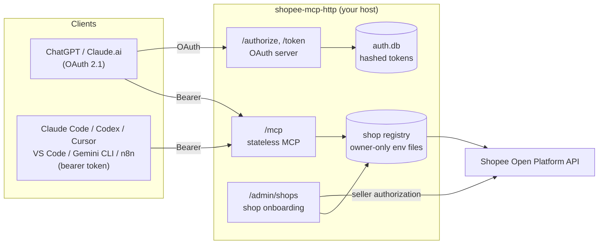

# Shopee Seller MCP

**Read-only Shopee Open Platform data (Ads, orders, products, finance) for AI agents, across several shops, over MCP.**

[](../../actions/workflows/tests.yml)


An unofficial [Model Context Protocol](https://modelcontextprotocol.io) server for the
[Shopee Open Platform](https://open.shopee.com/documents). Connect ChatGPT, Claude,
Claude Code, Codex, Cursor, VS Code, Gemini CLI, n8n or your own agents to one or more
Shopee shops and ask questions such as *"compare Ads spend and direct GMV for store-a and
store-b last month"*. Not affiliated with or endorsed by Shopee.

## Features

- **Read-only by design.** Multi-shop and remote modes expose read endpoints only; write tools cannot be enabled there.
- **Multi-shop.** Each shop has its own credentials and an alias (`store-a`, `store-b`). Every call names its shop explicitly; there is no default shop and no fallback.
- **Ads tools.** `get_ads_balances` and `get_ads_summary` (CPC expense, direct/broad orders and GMV) with explicit handling of missing or partial data.
- **Typed catalog tools.** Individual Shopee v2 read endpoints (products, orders, payments, returns, logistics, Ads, AMS and more) as typed MCP tools.
- **Remote HTTP mode.** Stateless Streamable HTTP at `/mcp` with OAuth 2.1 (ChatGPT and Claude.ai connectors) and static bearer tokens (CLIs, IDEs, n8n, scripts).
- **Browser shop onboarding.** Add or remove shops at `/admin/shops` without SSH. Changes apply without a restart.
- **One-command client setup.** `shopee-mcp-http connect <client>` prints or merges the right config for each MCP client.
- **Self-hosted.** Run it on your own VPS (systemd and nginx) or any Docker host with a persistent volume.

## How it works



1. You register a Shopee Open Platform app and deploy this server with its partner credentials.
2. At `/admin/shops` you add shops. The seller approves your app on Shopee and is redirected back to `/callback`; the server exchanges the code and stores the shop's tokens in an owner-only file.
3. MCP clients connect to `/mcp` with OAuth or a bearer token and call tools with an explicit `shop` alias. Shopee access tokens are refreshed automatically.

## Quick start

All remote options need a public **https** URL. It is the OAuth issuer and the base of the Shopee redirect URL (`<public-url>/callback`).

| Option | Best for | Guide |
| --- | --- | --- |
| (a) VPS with systemd and nginx | Recommended. Full control, Cloudflare in front | [docs/DEPLOY.md](docs/DEPLOY.md#vps-with-systemd-and-nginx) |
| (b) Docker | Any container host with a persistent volume | [below](#b-docker) and [docs/DEPLOY.md](docs/DEPLOY.md#docker) |
| (c) Local stdio | One machine, one user | [docs/DEPLOY.md](docs/DEPLOY.md#local-stdio) |

Free hosting tiers without persistent storage are not supported yet: Shopee refresh tokens rotate and must survive restarts.

### (b) Docker

```bash
docker build -t shopee-seller-mcp .
docker run -d --name shopee-mcp -p 8080:8080 -v shopee-mcp-data:/data \
  -e SHOPEE_MCP_PUBLIC_URL=https://mcp.example.com \
  -e SHOPEE_MCP_ADMIN_PASSPHRASE='a-long-random-passphrase' \
  -e SHOPEE_PARTNER_ID=123456 -e SHOPEE_PARTNER_KEY='your-partner-key' \
  shopee-seller-mcp
```

Put a TLS reverse proxy for `https://mcp.example.com` in front of port 8080. Every variable is listed in [`.env.example`](.env.example).

## Shopee Open Platform setup

1. Create a developer account in the Shopee Open Platform console and complete verification.
2. Create an app of type **Seller In-House System** (for shops you operate). Note the sandbox (test) and live **Partner ID** and **Partner Key**.
3. Set the app's **redirect URL domain** to your public URL, for example `https://mcp.example.com`. Sellers are sent back to `https://mcp.example.com/callback`.
4. Request the API permissions you need (for example Ads, Product, Order, Payment).
5. Test with a sandbox shop, then submit the app to **Go Live** and use the live credentials for real shops.

Partner credentials are read only from the server environment: `SHOPEE_PARTNER_ID`/`SHOPEE_PARTNER_KEY` (live), and optionally `SHOPEE_SANDBOX_PARTNER_ID`/`SHOPEE_SANDBOX_PARTNER_KEY`. When the sandbox pair is not set, sandbox onboarding uses the main pair. Credentials are never entered in the browser.

## Adding shops

Open `https://<your-host>/admin/shops` and sign in with the operator passphrase.

- **Add shop**: choose an alias (for example `store-a`), the environment (sandbox or production) and the authorization period, then click *Continue to Shopee*. Sign in as the seller and approve the app. You return to `/callback` and the shop is available to MCP clients immediately.
- **Main account (several shops at once)**: on the Shopee login page, sign in with the *main account* that manages your shops and tick the shops to authorize. Shopee returns a `main_account_id` instead of a `shop_id`. You then see the authorized shop IDs (with shop names when Shopee returns them), pick which ones to add and give each an alias. The alias you typed in *Add shop* is used as the default prefix. Each selected shop gets its own credential file and is refreshed independently.
- **Remove shop**: removes the alias and deletes its stored tokens.
- The list shows alias, environment and authorization expiry. To renew, remove the shop and add it again before the authorization expires.

The `shopee-auth` CLI flow and a hand-written shops file still work; see [docs/DEPLOY.md](docs/DEPLOY.md#shops-file-and-cli-authorization).

## Connecting clients

The MCP endpoint is `https://<your-host>/mcp`.

| Client | How |
| --- | --- |
| ChatGPT | Add a custom MCP connector with the URL and **OAuth**. Approve on the consent page with the operator passphrase. |
| Claude.ai, Claude Desktop | Add a custom connector with the URL. OAuth is discovered automatically. |
| Claude Code, Codex, Cursor, VS Code, Gemini CLI, Windsurf | `shopee-mcp-http connect <client> --url https://<your-host>/mcp` |
| n8n | MCP Client Tool node, HTTP Streamable transport, Header Auth `Authorization: Bearer <token>` |
| OpenAI Agents SDK, LangChain/LangGraph | Streamable HTTP with a bearer header; see [docs/INTEGRATIONS.md](docs/INTEGRATIONS.md) |

Bearer tokens come from `shopee-mcp-http token create --auth-file <auth.db> --label <name>` and are printed once.

```bash
export SHOPEE_MCP_TOKEN=smcp_...
shopee-mcp-http connect cursor --url https://mcp.example.com/mcp           # print snippet and target path
shopee-mcp-http connect cursor --url https://mcp.example.com/mcp --write   # merge into ~/.cursor/mcp.json (with backup)
```

Generated configs reference `$SHOPEE_MCP_TOKEN` instead of storing the token, unless you pass `--inline-token`. Without Python, use [`scripts/install-agent.sh`](scripts/install-agent.sh) for Claude Code, Codex and Cursor. More in [docs/INTEGRATIONS.md](docs/INTEGRATIONS.md).

## Tools

| Tool | Arguments | Description |
| --- | --- | --- |
| `list_connected_shops` | none | Configured aliases and environments. No Shopee request. |
| `get_ads_balances` | `shops` (1-25 aliases) | Current Ads credit balance per shop (paid and free credits combined). |
| `get_ads_summary` | `shops`, `start_date`, `end_date` (`DD-MM-YYYY`) | Per-shop CPC Ads expense, impressions, clicks, direct and broad orders, items and GMV. |
| Catalog tools, e.g. `v2_product_get_item_list`, `v2_order_get_order_list`, `v2_ads_get_all_cpc_ads_daily_performance` | `shop` plus the endpoint's `request` | One Shopee v2 read endpoint per tool, with validated input. |

Example: `get_ads_summary` with `{"shops": ["store-a", "store-b"], "start_date": "01-10-2026", "end_date": "31-10-2026"}`.

## Data semantics

- **Direct and broad attribution stay separate.** They are never added together, and CPC numbers are never combined with GMV Max or other campaign types.
- **Long ranges are chunked.** Two or more days use the daily endpoint in chunks of at most 30 days; a single day uses the hourly endpoint. One call may span up to 366 days and 60 Shopee requests. Shopee keeps about six months of Ads history, so older dates come back as missing.
- **Gaps are explicit.** Failed or missing dates are listed and never treated as zero. `totals` is set only when the whole period is covered; otherwise `partial_totals` covers `covered_dates`.
- **No cross-shop sums.** Each shop is reported separately.
- **No currency.** Shopee's Ads APIs do not return a currency; values are in each shop's local currency.
- Field names are Open API names. Reconcile with Seller Centre before using numbers in reports.

## Security model

- Read-only in multi-shop and HTTP modes (`--allow-write` is rejected).
- Every `/mcp` request needs a bearer token: a static token or an OAuth access token bound to this server's resource URL. Only SHA-256 hashes are stored, in an owner-only SQLite file.
- OAuth 2.1 with PKCE S256, dynamic client registration limited to ChatGPT, Claude and loopback redirect URIs, rotating refresh tokens, and an operator-passphrase consent page.
- `/admin/shops` uses the same passphrase, single-use CSRF tokens and throttling as the consent page. Shop authorization `state` values are single-use and bound to the admin session that started them.
- Shop tokens live in owner-only (`0600`) files in a `0700` directory. Codes, tokens, passphrases and query strings are never logged.
- The server binds `127.0.0.1` unless `--host` is given. A non-loopback bind requires an https public URL, and client-IP headers are then trusted only from `--trusted-proxy` networks.

Details: [docs/SECURITY.md](docs/SECURITY.md).

## Limitations and disclaimer

- Unofficial project; not affiliated with, endorsed by or supported by Shopee. Shopee names and trademarks belong to their owners.
- Available endpoints depend on your app's permissions, region and account type. Not every catalog endpoint has been verified in every region.
- Ads summaries have not been reconciled with Seller Centre in every market. Check definitions before reporting.
- Shop tokens are access-controlled on disk but not encrypted. Secure the host, the disk and its backups.
- Run one instance per data directory: admin sessions and pending shop authorizations are kept in memory.
- Review Shopee's terms and data policies before production use.

## License

Released under the [MIT License](LICENSE).
